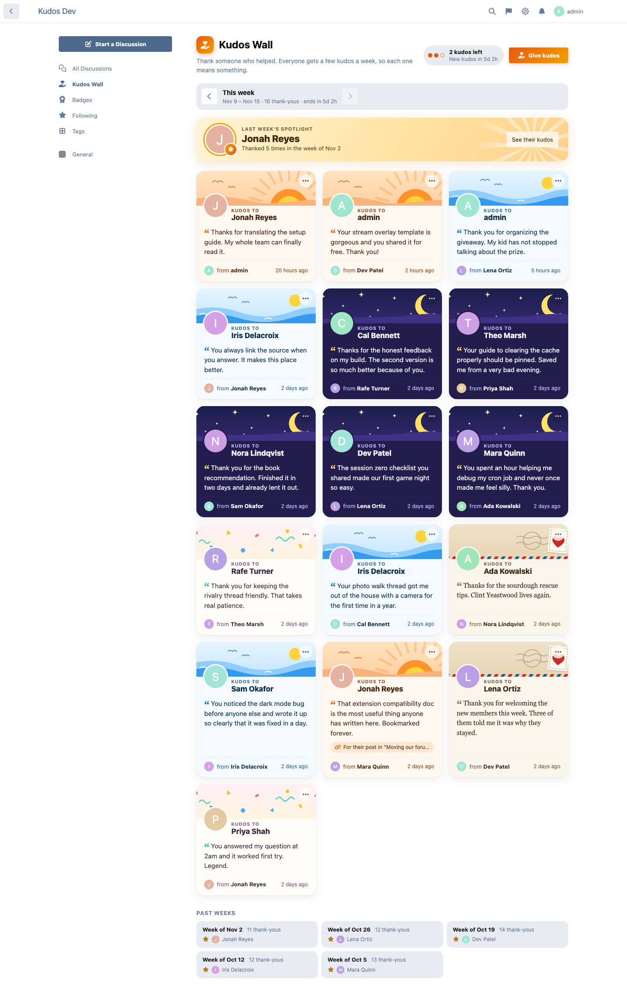
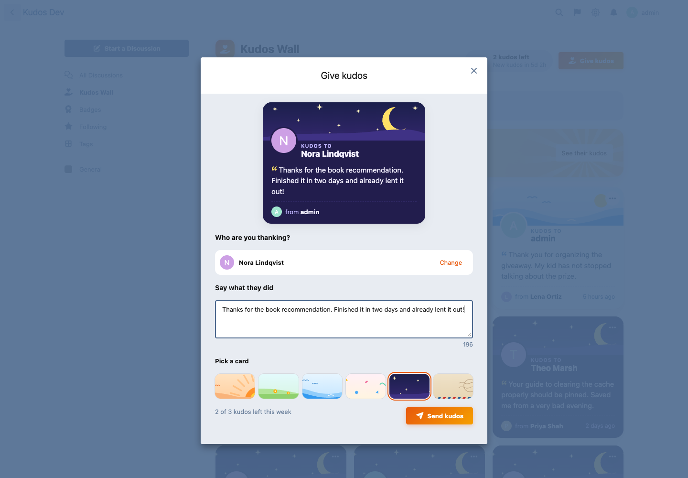
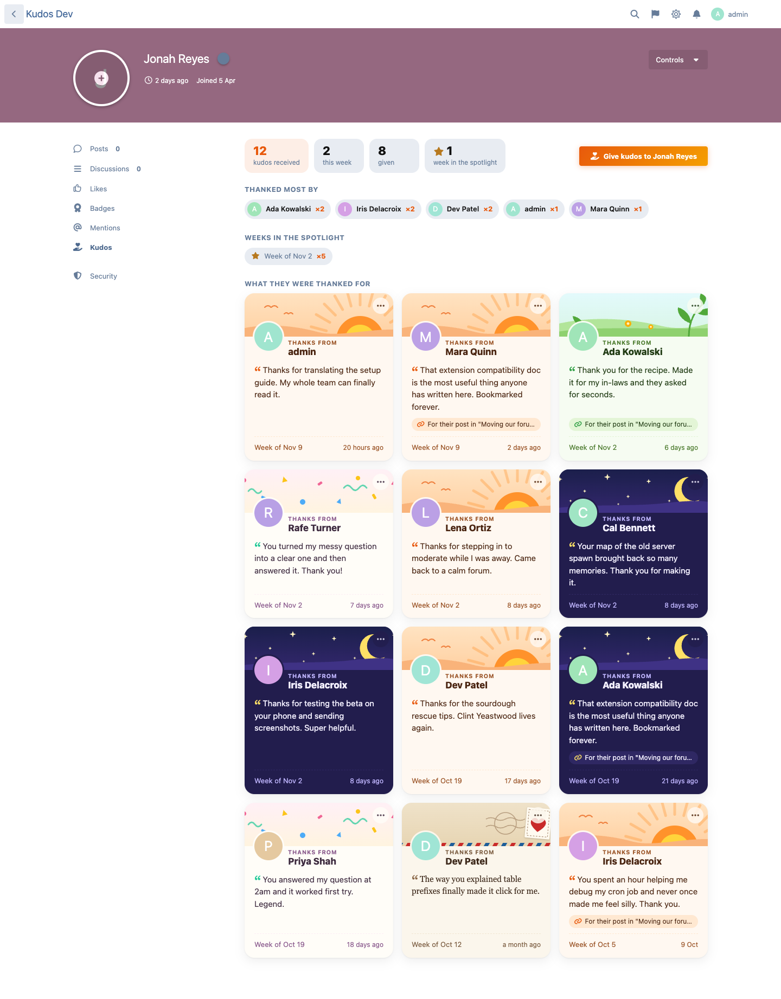
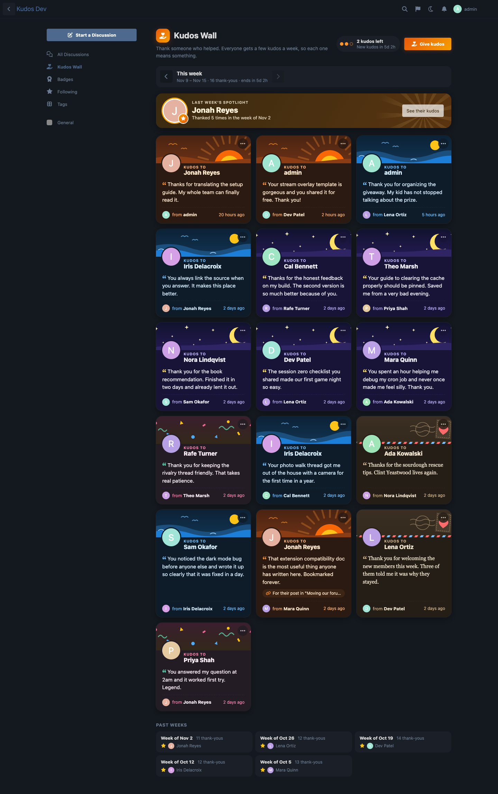
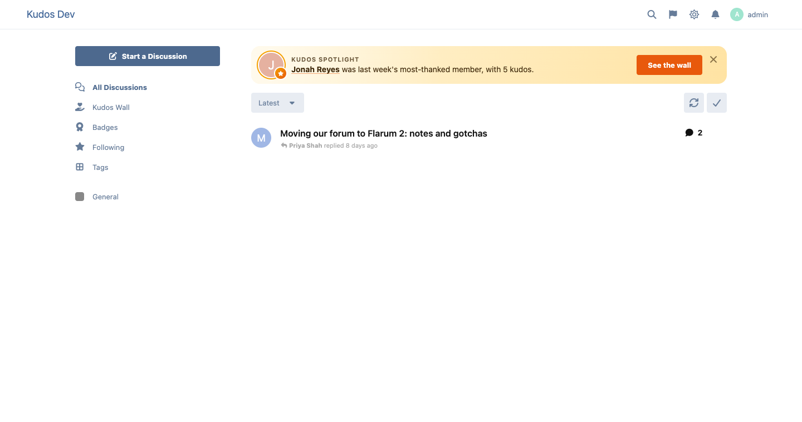
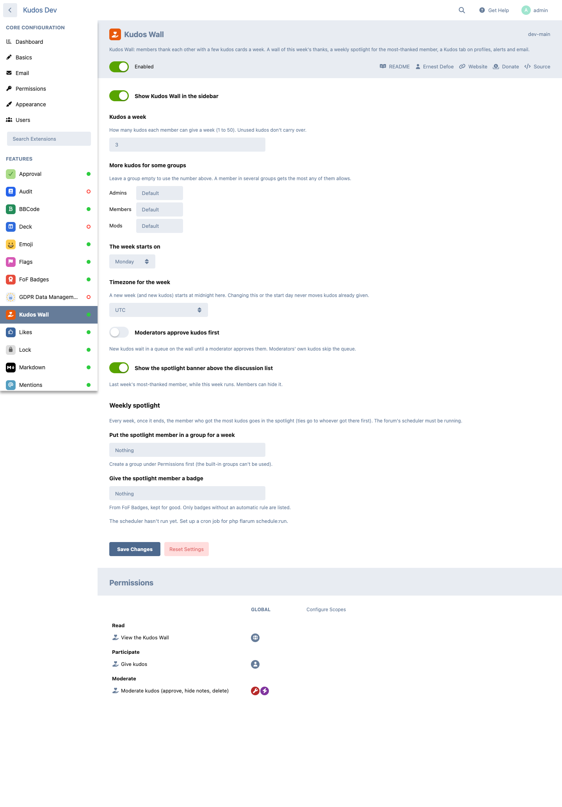
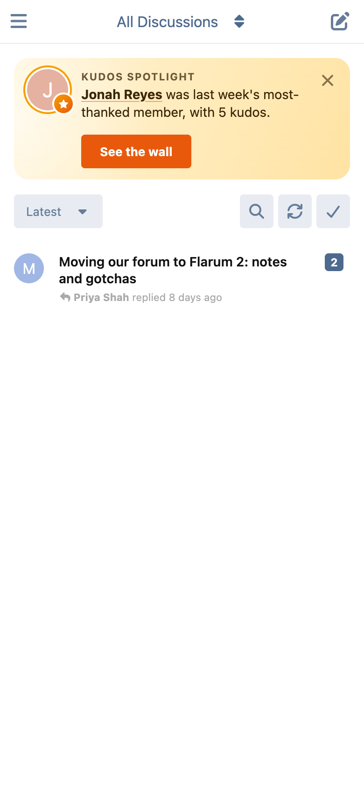

# Kudos Wall

[](LICENSE) [](https://packagist.org/packages/ernestdefoe/kudos)

A [Flarum 2](https://flarum.org) extension. Members thank each other with a few kudos cards a week.

Every member gets a few kudos a week (3 by default). They give one to someone who helped, with a short note and, if they like, a link to the post that helped. Kudos are scarce, so they mean more than a like: you can't thank yourself, you can thank the same person once a week, and unused kudos don't carry over. This week's thanks fill **the Wall**, and every week the most-thanked member goes in the **spotlight**.



## What members get

- **The Wall** (`/kudos`): this week's thanks as cards (who was thanked, the note, who from, the post that helped), with how many kudos you have left and when new ones arrive. Past weeks stay in the archive below.
- **Give kudos** from the Wall, from the menu on anyone's post (the post comes along) or from a member's profile. Pick who, write a few words, pick a card, and see it exactly as it will look before you send it.
- **Six card designs**, drawn for this extension: Sunrise, Meadow, Tide, Confetti, Starlight and Letterpress, each tuned for light and dark mode.
- **The weekly spotlight**: once a week ends, its most-thanked member is featured on the Wall and in a banner above the discussion list (members can hide it). Ties go to whoever got there first.
- **A Kudos tab on profiles**: kudos received, this week, kudos given, weeks in the spotlight, the members who thank them most, and every note.
- **Alerts**: "Sam gave you kudos" with the note, and one for the spotlight. Email for either is the member's choice in their notification settings.



## Fair by design

- The allowance is decided on the server under a row lock: two gives fired at once can't both pass (tested with 12 simultaneous requests: exactly the allowance gets through, and exactly one to the same person).
- Never yourself; once per person per week (a unique key too); a linked post must be the receiver's, and one the giver can read.
- The week starts at midnight on the day the admin picks (Monday by default), in the forum's timezone (Festoon's or Fanfare's when one is set, otherwise UTC) or one the admin picks. Changing either never moves kudos already given.
- The spotlight runs on the scheduler, once per week whatever happens: a second run, an overlapping run or a run that failed half way never spotlights twice or skips the rewards.

## Privacy

- A forum closed to guests shows guests nothing: no Wall, no profiles, no banner.
- Members the viewer can't see show as "a member", without a name, avatar or link. A linked post the viewer can't read is left off the card.
- With the moderation queue on, a kudos is only visible to its giver and moderators until it's approved.
- A note a moderator hides is gone everywhere (the Wall, profiles, alerts), and the kudos itself stays.
- With flarum/gdpr, a member's export includes the kudos they gave and received with the notes, and their weeks in the spotlight. Erasure deletes them; anonymizing keeps the kudos they gave on others' walls, from "a former member".

## Moderation

- **Moderation queue** (optional): new kudos wait until a moderator approves them; moderators' own skip the queue. The queue is a button on the Wall.
- **Hide a note** (and show it again) or **delete a kudos** from the card's menu. Deleting a kudos given this week gives the giver it back.

## Settings

Admin → Kudos Wall: kudos a week (1 to 50), more for some groups, the day the week starts, its timezone, the moderation queue, the spotlight banner, and the spotlight's rewards: a group worn for the week after (never a built-in group) and a [FoF Badges](https://github.com/FriendsOfFlarum/badges) badge kept for good (only listed when FoF Badges is enabled). It also says when the scheduler last ran. Permissions: view the Wall, give kudos, moderate kudos.

> **The scheduler must run** (`php flarum schedule:run` every minute from cron): it picks the weekly spotlight.

## Installation

```sh
composer require ernestdefoe/kudos
```

## Updating

```sh
composer update ernestdefoe/kudos
php flarum migrate
php flarum cache:clear
```

## Links

- [Packagist](https://packagist.org/packages/ernestdefoe/kudos)
- [GitHub](https://github.com/ernestdefoe/kudos)
- ☕ [Buy me a coffee](https://buymeacoffee.com/ernestdefoe)

## More screenshots

| | |
|---|---|
|  |  |
|  |  |
|  | |
